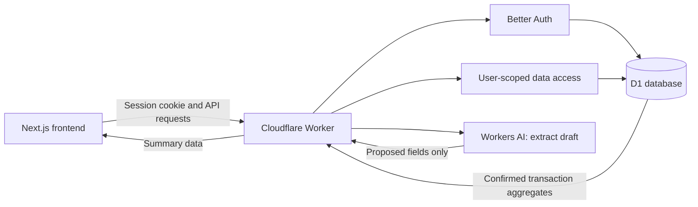
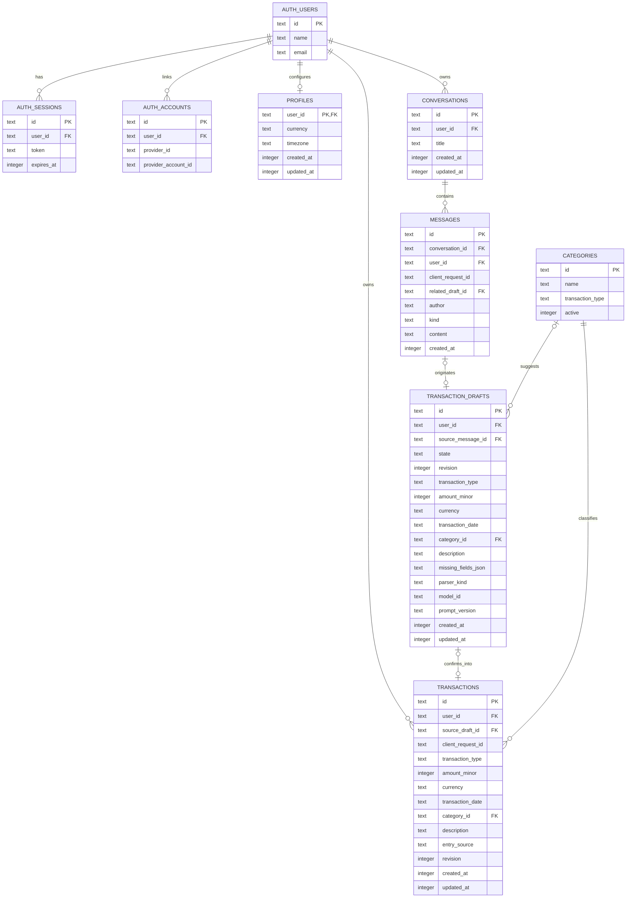

# Database architecture

Proposed design · 14 November 2026 · Cloudflare D1

This document defines the database design for the [Money Tracker idea](idea.md). The [chat and AI flow](chat-ai-flow.md) explains how records are created. This is a design, not an implemented migration.

## Design decision

Use one D1 database for authentication, user preferences, chat history, transaction drafts, and confirmed transactions. Chat history explains what happened; **only confirmed transactions contribute to financial reports**.

The earlier approach kept drafts in browser state. This proposal persists conversations and drafts so users can reopen their chats, resume clarification, and trace a saved transaction to its source message. Raw chat retention is a product choice: start with a configurable 30-day retention period for messages and abandoned drafts, disclosed to users. Keep confirmed transactions until users delete them. Expiring chat must not delete financial records.

## System boundary

The browser and AI never connect directly to D1. All financial reads and writes pass through authenticated Worker code.

## Entity relationship diagram

Auth entities below are conceptual: generate the actual Better Auth schema for the selected version rather than copying these field lists as a complete auth implementation.

`user_id` is intentionally repeated on messages and drafts to support direct ownership checks. Enforce matching ownership across parent/child relationships with composite foreign keys and corresponding unique parent keys, not independent foreign keys alone.

## What each table stores

| Table | Purpose | Notes |
| --- | --- | --- |
| Auth tables | Identity, OAuth accounts, sessions | Better Auth owns schema and lifecycle; additional verification tables may be generated |
| `profiles` | Currency and IANA timezone | Initially INR and suggested Asia/Kolkata; ensure a profile exists before accepting transactions |
| `conversations` | A user-visible chat thread | One default thread per user initially; avoid automatically creating a thread every day |
| `messages` | User text and application-generated replies | `author`: user/assistant; `kind`: text, clarification, preview, receipt, error; nullable `related_draft_id` associates follow-ups/cards with a draft |
| `transaction_drafts` | Incomplete or reviewable extracted fields | Nullable financial fields while clarification is pending; not included in reports |
| `categories` | Fixed allowlist shared across users | For example transport, groceries, dining, bills, salary, other income/expense |
| `transactions` | Confirmed financial records | Complete validated fields; manual entries may have no source draft |

Assistant messages are rendered by application templates. Do not persist hidden reasoning, session tokens, or full AI prompts in messages. Parser/model/version fields on drafts provide minimal debugging context without duplicating raw model responses.

## Constraints and indexes

- Store monetary values as positive integer minor units: ₹30 → `3000` paise. The type supplies the direction: `expense` or `income`. Validate safe integer bounds in the API and add database checks.
- Store `transaction_date` as validated `YYYY-MM-DD` in the user's accounting timezone. Store operational timestamps as UTC Unix milliseconds. A transaction date and creation timestamp represent different things.
- Draft states: `needs_clarification`, `ready`, `confirmed`, `cancelled`, `failed`. Allow nullable extracted fields in incomplete drafts; enforce complete fields for a confirmed transaction.
- Add `CHECK` constraints for allowed types/states, positive amounts, entry sources, and draft/transaction revisions. Validate calendar dates and the configured currency in application code too.
- Use stable category IDs and ensure a category's income/expense type matches the draft or transaction. Enforce this with a composite reference to `(category_id, transaction_type)` plus a unique category key, or equivalent constraints.
- Unique `(user_id, client_request_id)` on user messages prevents network retries from inserting the same input twice. Require the key for user-authored messages; it can be null on application replies.
- Unique `source_message_id` on drafts gives an original message at most one draft. Clarification replies update that draft rather than creating another one.
- Unique nullable `source_draft_id` on transactions means one draft can produce at most one transaction. Unique `(user_id, client_request_id)` on transactions also protects manual saves.
- Add `(user_id, transaction_date, id)` on transactions for date-range pagination and summaries, and `(user_id, created_at, id)` on conversations.
- Add `(conversation_id, created_at, id)` on messages and `(user_id, state, updated_at)` on drafts. Use stable cursor pagination, including the ID as a tie-breaker.

For same-owner relationships, references must cover both owner and identifier: for example, draft `(user_id, source_message_id)` references message `(user_id, id)`. The same principle applies to conversations/messages and transactions/drafts. The API must still authorize every operation.

Messages can optionally reference a related draft for clarification replies and application cards. Enforce matching ownership and conversation for this association. The original message is inserted before its draft; related replies are inserted afterward. Cleanup must clear message-to-draft associations before removing drafts to avoid a circular provenance reference. The ER diagram emphasizes the originating-message relationship; related follow-up messages form an additional many-to-one relationship with the draft.

## Example: one confirmed expense

Assume the message arrives on 14 November 2026 in Asia/Kolkata:

| Record | Example |
| --- | --- |
| Conversation | `conv_01`, owned by `user_01` |
| User message | `msg_01`: “Spent 30 Rs on Rickshaw to work” |
| Draft before confirmation | `draft_01`, source `msg_01`, ready, revision 1, expense, 3000 paise, INR, 2026-11-14, transport |
| Transaction after confirmation | `txn_01`, source `draft_01`, owned by `user_01`, same confirmed fields |
| Application reply | “Saved ₹30 under Transport for 14 Nov.” |

Editing a preview updates the draft revision. Editing a saved transaction updates the transaction revision and its `updated_at`; historical user text stays unchanged. Present transaction cards from current transaction data, because an old textual receipt may describe values before an edit.

## Writes, deletion, and ownership

Confirmation must atomically create the transaction and mark its draft confirmed using D1-compatible conditional statements/batch operations. Check the expected draft revision and state in the write itself. Do not rely on an earlier read to prevent stale confirmations. On replay, return the existing transaction; conflicting payloads under the same idempotency key must be rejected. Write a receipt with the same operation or derive it from the saved transaction so a reply failure does not lose the save result.

Use one server data-access layer requiring a validated user ID for list, get, update, delete, export, and aggregation operations. Never accept ownership from a request body or model output. Never query a private record by its ID alone.

Retention cleanup must detach nullable provenance links before deleting source messages/drafts, within a controlled atomic operation. Deleting a conversation removes its messages and drafts while preserving confirmed transactions; warn users that deleting a chat does not delete its ledger entries. Do not use an unconditional cascading delete from chats into transactions. Prefer explicit cleanup with restrictive foreign keys for these provenance relationships.

Deleting a transaction removes it from analytics. Keep its draft terminal (`cancelled`) so a delayed confirmation retry cannot recreate it. Hard deletion eventually removes its idempotency record too; document that retries after deletion are rejected against the terminal draft rather than treated as fresh entries. Account deletion explicitly removes all owned records, including auth sessions/accounts, without affecting shared categories.

## Dashboard and recovery

Dashboard queries read only `transactions`, filtered by session user, currency, and date range. Use SQL `SUM`/`GROUP BY` for income, expenses, category totals, and daily trends. Net cash flow is income minus expenses; it is not a bank balance. Never total drafts or message text, and never combine different currencies into one number.

Use D1 Time Travel for operational recovery and independent exports for longer retention. A restore can reintroduce recently deleted records; deletion procedures must account for restored backups. Do not copy production financial data into development casually.

Additional billing counters/rate-limit storage can be introduced when the AI integration is implemented. Keep them separate from the financial ledger and do not interpret chat message counts as exact model usage.
