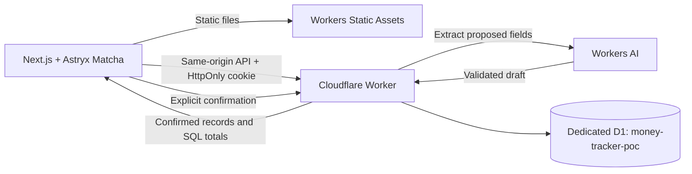

# Cloudflare proof of concept

Live URL: https://money-tracker-poc.kaushik0976.workers.dev

Deployed 14 November 2026. Initial deployment version: `70fcd724-b317-4ea1-82d2-f964d836dfe4`.

## Scope

This is a working infrastructure and transaction-entry proof, separate from the full multi-user MVP. Browser-isolated ledgers were explicitly selected for this iteration; Google login is deferred.



Implemented:

- Next.js static frontend and a small TypeScript Worker on one origin.
- Seven-day anonymous session cookie; only its SHA-256 hash is stored in D1. HTTPS cookies are Secure, HttpOnly, and SameSite=Strict. Mutations reject mismatched/missing Origin headers.
- D1-backed sessions, extraction requests/results, confirmed transactions, and SQL monthly summaries.
- Live Workers AI extraction using `@cf/meta/llama-3.3-70b-instruct-fp8-fast`, schema validation, bounded prompts/output, and an application timeout.
- Editable draft with explicit confirmation, or manual entry without inference.
- Integer paise, valid calendar dates, category/direction checks, and owned queries.
- Idempotent sends and saves, including concurrent confirmation retries.
- Monthly income, expenses, net cash flow, and up to 100 saved entries per session.
- Daily scheduled cleanup of expired sessions and their test data.

The Worker uses its AI binding; no separate model API key is embedded in the browser. The selected model and API format were checked against [Cloudflare's model documentation](https://developers.cloudflare.com/workers-ai/models/llama-3.3-70b-instruct-fp8-fast/) and exercised on the live deployment.

## Demo limits and lifecycle

Use **test data only**. A cookie is a bearer credential for this anonymous ledger, not a recoverable account. A different browser starts a different ledger; clearing the cookie loses access. Sessions expire seven days after creation without sliding renewal. Daily cleanup removes expired records, so deletion can lag expiry by up to a day. Provider recovery copies may retain historical data separately.

AI quota reservations are stored in D1 before inference: 10 extraction attempts/session/day and 50 across the demo/day, resetting by UTC date. Attempts count even if inference fails. These are request caps, not an exact neuron/spending meter. Existing account usage and Cloudflare's own quotas still apply. No paid plan was enabled as part of deployment.

To bound demo storage, sessions are capped at 2,000, transactions at 100/session and 5,000 globally. At capacity, new writes fail explicitly. These demo safeguards are not a complete public-service abuse prevention strategy.

The 20-second application timeout limits how long extraction is awaited; it does not guarantee cancellation of inference already running remotely. Failed/timed-out extraction is not automatically retried or saved as a transaction. Replaying an extraction key returns the saved response; an interrupted operation without a result asks for a new request or manual entry. Full lease recovery remains an MVP task.

No durable conversation UI, follow-up draft merging, revisions, editing/deleting saved entries, CSV export, charts, Google OAuth, or account recovery is included. For clarification, resend a complete sentence or fill the manual form. Drafts are editable locally before confirmation; they are not the full revisioned draft lifecycle in the architecture plan.

## Development and deployment

The checked-in Wrangler config points to the dedicated POC database. Database IDs are resource identifiers, not access credentials. Use a separate database/account config before adapting this to production.

```sh
npm ci
wrangler login
npm run db:local
npm run build
# Start full local app, using the exported frontend and local D1.
# AI is disabled here so manual-flow development does not invoke remote models.
npm run dev:worker -- --var AI_ENABLED:false
```

Open the URL printed by Wrangler, normally http://localhost:8787. `npm run dev` still previews the frontend on port 3000 but does not provide Worker APIs. After changing frontend source, rebuild `out/` before viewing it through Wrangler. Wrangler watches Worker source itself.

Alternatively copy `.dev.vars.example` to ignored `.dev.vars` to disable AI locally. **AI bindings access Cloudflare remotely even during local development** when invoked. Do not treat local AI tests as offline or cost-free.

To deploy subsequent changes to this POC:

```sh
npm run test
npm run lint
npm run typecheck
npm run build
npm run ui:check
npm run deploy:dry
npm run db:remote
npm run deploy
```

Only apply remote migrations after review. `npm run deploy` rebuilds the frontend and publishes both assets and Worker; it does not automatically apply migrations. Do not add secrets to Wrangler vars, browser code, Git, or this document.

## Verification

```sh
node scripts/smoke.mjs http://localhost:8787
# Writes isolated sample data and invokes two real AI requests:
node scripts/smoke.mjs https://money-tracker-poc.kaushik0976.workers.dev --ai
```

Completed verification:

- Unit checks: exact money conversion, invalid dates/categories, and Kolkata day boundaries.
- Local and remote API checks: D1 health, missing-session rejection, Origin protection, two-session isolation, invalid fields, duplicate/conflicting keys, concurrent saves, income/expense SQL totals.
- Live AI checks: fare extraction, cached extraction replay, saving its draft once, cross-session draft rejection, and missing-amount clarification without saving.
- Production static build, frontend and Worker type checks, lint, and Astryx diagnostics without failures. External font diagnostics remain a manual-review warning.
- Local and deployed browser flow at 1440, 390, and 320 CSS pixels: manual form → confirm → refresh → retained record; separate browser sees no record; no page errors or horizontal overflow.

All smoke-test records are synthetic and expire with their sessions. A successful small smoke test is not a load/cost benchmark. Wrangler reported 11 ms **startup time**; that is not per-request CPU consumption. Request CPU, detailed neuron costs, quota-exhaustion behavior, and cleanup/restore drills still need dedicated measurement before claiming guaranteed free production operation.

Logs/observability are disabled in the initial config to avoid collecting raw request context unnecessarily. API responses return safe errors, not internal model/database messages.


## Organization failure repair

Deployed version `05fed95b-f94b-4d5f-9f95-fd14ee998f51` fixes two issues found with “Got 15000 salary today”:

- The model returned a valid income amount/category/date but a null description. Candidate validation rejected it and mislabeled it as unavailable. Missing/blank descriptions now preserve the original input as display text; missing category uses the visible Other category. Required financial fields remain validated and missing/invalid values ask for clarification rather than being guessed.
- The browser reused a failed extraction request ID indefinitely, replaying its cached unavailable response. An explicit retry after unavailable now receives a fresh request ID. Network-uncertain requests still reuse their key to avoid duplicate inference; saved entries keep their existing idempotency behavior.

Diagnostics distinguish timeout, provider failure, and invalid output. Live diagnostic events contain stage, duration, issue paths/codes, and draft ID; they exclude chat text, model response, and exception messages. Persistent observability remains disabled.

Regression verification: exact salary input succeeded twice consecutively, followed by a lunch expense in the same session. A browser test simulated unavailable followed by success and verified distinct request IDs and a rendered draft. Added unit cases cover null/blank descriptions, missing categories, missing amount/type/date, invalid dates, and mismatched categories. Lint, types, static build, and Astryx built-output checks passed.
