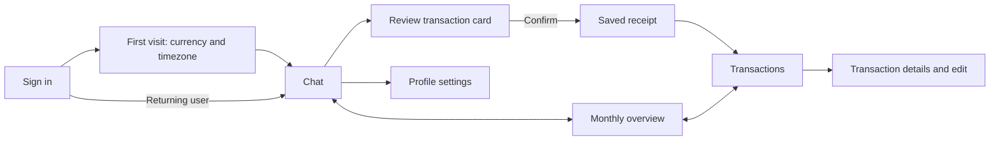

# UI plan: Astryx Matcha

Proposed design · 14 November 2026

## Direction and library decision

Use [Astryx with the Matcha theme](https://astryx.atmeta.com/themes?theme=matcha) as the app's primary design system. It replaces the earlier shadcn/ui proposal. The intended feel is calm and approachable, with enough structure to review financial records quickly.

The [theme documentation](https://astryx.atmeta.com/docs/theme) describes Matcha as earthy greens with DM Sans and Playwrite US Trad typography. Use the installed theme's actual semantic tokens rather than inventing approximate hex values. Reserve expressive typography for a short welcome heading or brand accent; amounts, dates, labels, tables, and chat use the readable body type. Exact visual tuning will be reviewed in the rendered app.

Keep light mode as the initial design reference. Check the installed Matcha theme's supported modes before promising a dark-mode option. Use restrained surfaces, subtle borders, one clear primary action per card, and tabular numerals for money. Green is the brand accent; distinguish income and expenses with explicit words and signs as well as color.

## Navigation and screen map

Default destination after onboarding: **Chat**, because quick recording is the central action. Keep three primary destinations: Chat, Overview, and Transactions. Settings lives under the profile menu. Do not add a separate Reports section in the MVP.



Use static paths `/login`, `/setup`, `/chat`, `/overview`, `/transactions`, and `/settings`. Chat thread IDs and transaction selections can use query parameters so arbitrary user-created IDs do not require build-time static pages. All private data comes from authenticated API requests.

## Responsive shell

| Viewport | Layout |
| --- | --- |
| Wide desktop, approximately 1200 px and up | Compact left navigation; main content; optional context panel on Chat |
| Tablet/small desktop | Navigation collapses; single main column; context moves into an expandable section |
| Mobile | Page title and profile action at top; three bottom navigation items; full-width content |

Treat these as layout targets, then adjust based on actual content rather than device names. The mobile composer sits above navigation and the software keyboard, respects safe-area insets, and never covers the latest draft or its confirmation buttons. Use one intentional message scroll region. Keep reading width around 640–760 px for chat; allow the overview more width.

## 1. Sign-in and setup

Use a compact sign-in panel with the app name, “Track your money, one message at a time”, and “Continue with Google”. Explain briefly that entries are saved only after confirmation. Include privacy information and a clear loading/error state; preserve a safe intended destination through sign-in.

After the first login, ask for currency and timezone. Suggest INR and Asia/Kolkata, show the choices, and let the user confirm. Currency changes after transactions exist need a defined migration policy; initially lock the ledger currency and explain this in Settings. Timezone can change for future date interpretation without silently rewriting historical transaction dates.

## 2. Chat: the main screen

Desktop layout sketch; this is a wireframe, not a final visual mockup:

```text
┌──────────────┬──────────────────────────────────┬──────────────────────┐
│ Money Tracker│ Chat                             │ This month           │
│              │ Add an expense or income         │ Spent      ₹8,420    │
│ Chat         │                                  │ Income    ₹25,000    │
│ Overview     │ You: Spent 30 Rs on Rickshaw      │ Net flow  ₹16,580    │
│ Transactions │                                  │                      │
│              │ Review transaction               │ Recent saved entries │
│              │ Expense       ₹30.00             │ Transport     −₹30   │
│              │ Transport · 14 Nov               │ Dining       −₹120   │
│              │ Rickshaw to work                 │                      │
│              │ [Edit] [Cancel] [Confirm]        │ View transactions    │
│              │                                  │                      │
│ Profile      │ [Type an expense or income…] [↑] │                      │
│              │ Add manually                     │                      │
└──────────────┴──────────────────────────────────┴──────────────────────┘
```

All amounts above are illustrative. The right panel is secondary and collapses away on mobile; it must never crowd out chat. Label its values as this month's confirmed records.

**Empty chat:** short explanation and three example prompts: “Spent ₹120 on lunch”, “Received ₹25,000 salary today”, and “Paid ₹800 for groceries yesterday”. Selecting a prompt fills the composer for editing; it does not send automatically.

**Composer:** multiline plain text, Send control with an accessible name, and persistent “Add manually” access. Desktop Enter sends and Shift+Enter inserts a line break; do not send during IME composition. On mobile, keep an explicit Send control. Preserve unsent text when an API request fails.

**Conversation:** group messages by local day, show concise timestamps, and keep app responses short. Start with one default conversation. Offer access to retained history without a large thread-management sidebar. Show a settings notice explaining the proposed chat retention period; the ledger remains available after chat text expires.

### Transaction review card

This custom product component is the central interaction, composed from Astryx primitives:

- Clear “Review transaction” status and income/expense label.
- Prominent amount and currency.
- Category, full date, and description visible before confirmation.
- Edit, Cancel, and primary Confirm actions. On small screens, stack actions without clipping.
- Explicit “Not saved yet” helper text until confirmation succeeds.

Editing expands a small form inside the card or opens a focused dialog on narrow screens. Include amount, type, category, date, and description. Revalidate before enabling confirmation. Changing category should not trigger another AI request.

During confirmation, disable repeat actions and show “Saving…”. Mark the card saved only after server acknowledgment. The saved state shows a compact receipt and “View transaction”. If the response is lost, show “Checking save status…” while resolving the same request; do not offer a fresh save that could duplicate it.

Only one clarification is active in the composer at a time. Show “Replying to: Lunch expense” with the pending question. Users can cancel or explicitly start a separate entry. Incomplete cards explain what is missing; they do not resemble saved receipts.

## 3. Monthly overview

Place the month selector at the top, followed by three summary values: Income, Expenses, and Net cash flow. Explain net cash flow as recorded income minus expenses; do not label it Balance or Savings.

Below the summary, show category spending as a horizontal bar chart and spending over the month as a daily trend. Bars make category amounts easier to compare than a crowded donut. Use Recharts for charts initially, with color and typography bound to Astryx tokens; confirm the library boundary during implementation. Provide a readable list/table equivalent and clear currency units.

Finish with five recent transactions and a “View all” link. Month changes update summaries, charts, and recent entries consistently. A month without entries shows a helpful empty state, not a fabricated trend or percentage comparison. Drafts are never counted.

On mobile: stack the summary values compactly, then the category breakdown, trend, and recent list. Do not add budgets, forecasts, or financial advice to the MVP.

## 4. Transactions

Desktop uses a table with Date, Description, Category, Type, and Amount. Mobile uses a date-grouped list with the amount and direction immediately readable. Filters include month/date range, income/expense, category, and description search. Label search scope clearly.

Selecting a record opens details with Edit and Delete. Use a focused dialog or details panel appropriate to the viewport; do not assume specific Astryx overlay APIs until inspected. Warn before deletion and return focus to the invoking control. Do not show Undo unless backed by an implemented recovery mechanism.

Paginate rather than rendering the full ledger. “Export CSV” exports the indicated filter scope; show it explicitly. Updates refresh overview totals as well as the list. A conflict from a newer revision offers to reload the current record instead of overwriting it.

## 5. Settings

Include profile/sign-out, ledger currency, timezone, chat retention explanation, export access, and account deletion. “Delete conversation” explains that saved transactions remain. “Delete account” requires a clear confirmation and removes the user's records according to the deletion policy.

Do not expose model names, neuron quotas, database details, or prompt versions in ordinary product settings. When AI is unavailable, say “Chat entry is temporarily unavailable. You can still add a transaction manually.”

## Component mapping

The [Astryx catalog](https://astryx.atmeta.com/components) includes the following building blocks. Display names below are catalog labels, not assumed import names or final APIs; inspect component documentation before implementation.

| Product area | Astryx building blocks |
| --- | --- |
| Chat | Chat Layout, Chat Message, Chat Composer, Timestamp |
| Draft and receipt | Card, Text, Badge, Button |
| Manual entry and edits | Field, Number Input, Selector, Date Input, Text Input |
| Loading and errors | Skeleton, Spinner, Banner, Empty State |
| Actions and filters | Dropdown Menu, Segmented Control, Date Range Input |
| Navigation and records | Appropriate navigation/table/overlay primitives after inspecting supported APIs |

Keep AI tool-call displays and raw structured outputs out of the user flow. Preview cards are application UI, not markdown generated by the model.

## State and accessibility checklist

| State | User sees | Available next step |
| --- | --- | --- |
| Parsing | “Organizing your entry…” | Wait; retained input stays visible |
| Needs clarification | One focused question with draft context | Reply, cancel, or start separate entry |
| Ready | Editable preview, not saved | Edit, cancel, confirm |
| AI failure/quota | Plain explanation | Explicit retry or manual form |
| Offline | Connection notice; unsent input retained | Retry on reconnect; no implied offline save |
| Saving/unknown outcome | Saving or checking status | Await resolution of same request |
| Saved | Receipt backed by transaction | View/edit transaction |
| Session expired | Sign-in prompt | Sign in and resume safe local input |
| Empty/filter mismatch | Specific empty state | Add entry or clear filters |

Use visible focus, keyboard-operable menus/dialogs, labeled inputs, field-level errors, and sufficiently large touch targets (aim for 44 px). Check contrast in the actual Matcha theme. Never rely on color alone for transaction direction or status. Announce parsing/save results politely without repeatedly announcing the entire conversation. Respect reduced motion, preserve focus during updates, and support 200% zoom without losing actions.

## Integration and delivery plan

[Astryx getting started](https://astryx.atmeta.com/docs/getting-started) requires React 19+, its StyleX peer dependency, and theme setup. Use the Matcha package and production CSS/font wiring through the documented CLI workflow. Keep compatible Astryx package versions aligned. Astryx is beta; pin the verified versions and test upgrades deliberately.

Start from its documented plain Next.js example and theme CSS approach. Custom StyleX authoring is optional; ordinary CSS can handle product layout. Do not add Tailwind solely for layout unless there is a concrete need; avoiding two styling foundations simplifies cascade behavior. Use per-component imports and keep dependencies that build CSS out of the Worker runtime where possible.

Implementation order:

1. **Foundation proof:** Matcha theme, body typography, buttons/forms, Next.js static production build, and direct-route navigation. Review real rendered components at mobile/desktop sizes.
2. **Chat prototype:** realistic fixtures covering empty chat, clarification, ready draft, saved receipt, and failure. Include manual entry and keyboard behavior before backend integration.
3. **Overview and ledger:** matching fixture totals, responsive charts/list/table, filters, details/edit/delete, and export affordance.
4. **API integration:** connect actual states, idempotent save resolution, authenticated loading, and cross-page updates.
5. **Validation:** keyboard and screen-reader smoke checks, mobile keyboard/composer behavior, contrast/zoom, slow/offline states, and bundle/build review.

UI-01 is implemented: the shell is adapted from Astryx’s `shell-side-nav` template with a top header, shared sidebar, Layout content/footer, and mobile bottom navigation. All six static routes exist. The mobile Entries label links to Transactions and retains its full accessible name. The profile control uses an accessible Popover containing navigation links.

The POC entry logic now lives in a shared provider, keeping input, draft, uncertain-save key, and selected ledger month through in-app route changes. Overview and Transactions use existing real POC data; search and type filtering are scoped to the loaded month. Login/setup accurately explain the browser demo and fixed preferences. Existing POC account/data limitations remain.

Full chat transcript/composer behavior, complete draft lifecycle, charts, saved-record actions, and actual authentication/onboarding remain tracked separately. UI-01 does not mark those tasks complete. Next: UI-02 chat composition and history.


Google authentication implementation is now prepared in source: signed-out users see Continue with Google; account sessions gate private views; Profile shows the signed-in name/email and Sign out; saved records are owned by account IDs rather than browser cookies. Login/setup no longer offer anonymous access. Live activation and real Google consent/callback verification are pending the credentials listed in [Google auth setup](google-auth-setup.md). UI fixtures test account states; actual signed-session ownership is tested against the Worker separately.
